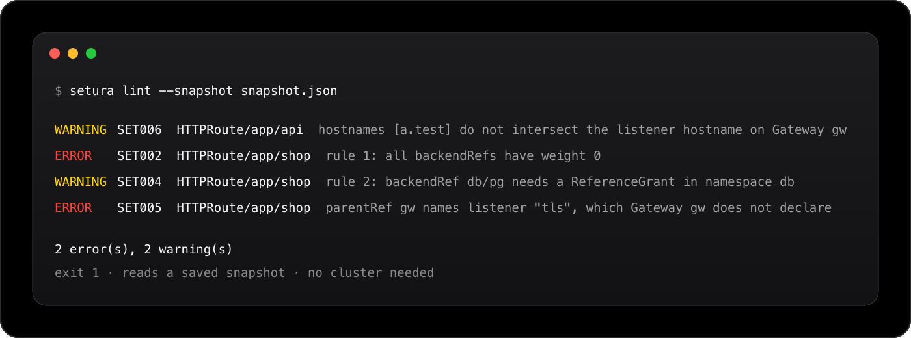

<div align="center">


# Zyvor Setura

**Know what actually answers.** A built-in Gateway API gateway and a client-side verifier in one Go binary. No Envoy required.

[](https://github.com/zyvorai/zyvor-setura-gateway/actions/workflows/ci.yml)
[](https://github.com/zyvorai/zyvor-setura-gateway/releases)
[](go.mod)
[](LICENSE)

[](https://zyvor.dev/buy?utm_source=github&utm_medium=setura&utm_campaign=readme_hero)
[](mailto:sales@zyvor.dev?subject=Zyvor%20Setura)
[](https://zyvorai.github.io/zyvor-setura-gateway/)

[Quickstart](#quickstart) · [Commands](#commands) · [Lint](#lint-your-routes-before-traffic-does) · [Change safely](#change-it-without-guessing) · [Route map](docs/map-ai.md) · [Operators guide](docs/operators.md) · [Pricing](#pricing-and-licensing)


</div>

---

A route can be **Accepted**, **Programmed**, and still send your users to the wrong application. Setura closes that gap from both ends:

- **A gateway of its own.** `setura gateway` is a Gateway API data plane written in Go and built into the binary: HTTP and HTTPS listeners, weighted routing, header and path matching, redirects, rewrites, TLS with SNI, hot reload and status reporting. **You do not need Envoy, Envoy Gateway or any other proxy.**
- **A verifier for any gateway.** Setura sends a real request down the client path and tells you which hop broke, who really answered, and whether it is safe to roll forward. It works against its own gateway, Envoy Gateway, Traefik, or anything that speaks HTTP.

It is one static Go binary for macOS and Linux. It reads through your existing `kubectl` credentials, never changes your cluster unless you ask it to, and uses only the Go standard library.

<div align="center">

</div>

## Why Setura

| | |
| --- | --- |
| **Client-side truth** | Probes originate at the CLI, bypass proxy environment variables, preserve the HTTP `Host` and TLS server name, and can pin a numeric address (`--address`) without touching DNS. |
| **Gates, not guesses** | `gate` requires current parent status *and* a streak of passing probes, and resets the streak if the route object changes while it is checking. |
| **Evidence you can cite** | Every result is structured JSON with per-stage state. `ai` extracts numbered evidence and can ask a local Ollama model, which must cite evidence IDs or its answer is rejected. |
| **No cluster needed to lint** | `lint` and `map` work on a saved snapshot, so route review runs on a laptop or in CI. |
| **Honest exit codes** | `0` passed, `1` an observed failure, `2` a setup or usage error. A typo never looks like an outage. |

## Quickstart

**Install** a release binary from [Releases](https://github.com/zyvorai/zyvor-setura-gateway/releases) (macOS and Linux, arm64 and amd64), or use any of these ([all options](docs/install.md)):

```sh
sh install.sh --dry-run                    # checksum-verified installer, shows its plan first
go install github.com/zyvorai/zyvor-setura-gateway/cmd/setura@latest
docker run --rm ghcr.io/zyvorai/zyvor-setura-gateway:latest version
setura version
```

**Run a gateway and verify it in 30 seconds**, with no Kubernetes and no Envoy:

```sh
setura gateway up examples/builtin-demo.json
```

```text
demo backend orders-v1      http://127.0.0.1:19101
demo backend orders-v2      http://127.0.0.1:19102
serving setura-demo/dev/web http://orders.mactra.test (listening on 127.0.0.1:8080)
admin http://127.0.0.1:19000 (/ready /config /stats /status)
```

The demo is a 90/10 canary. In another terminal:

```sh
setura explain http://orders.mactra.test:8080/checkout --address 127.0.0.1
setura bench   http://orders.mactra.test:8080/checkout --address 127.0.0.1 --requests 400 --concurrency 10
curl -s http://127.0.0.1:19000/stats      # per-route and per-backend counters
```

**Probe anything.** Setura also ships a tiny identity backend, handy for trying the verifier on its own:

```sh
setura echo --name hello --listen 127.0.0.1:9090
setura explain http://localhost:9090/ --backend hello
```

```text
  http://localhost:9090/

  ✓ dns      ok         addresses=['::1', '127.0.0.1']
  ✓ tcp      ok         peer=127.0.0.1
  – tls      unused
  ✓ http     ok         status=200 expected=200
  ✓ backend  ok         identity=hello
  – assert   unused

  ✓ Passed in 2.3 ms
```

**Already run Envoy Gateway?** Setura can publish and verify it too. Use an isolated K3s cluster, or a cluster whose kubeconfig your Mac can reach. Check `kubectl config current-context` first, because the demo fixture creates a namespace and a cluster-scoped GatewayClass.

```sh
helm install eg oci://docker.io/envoyproxy/gateway-helm --version v1.8.6 \
  -n envoy-gateway-system --create-namespace --wait --timeout 5m
kubectl apply -f examples/demo.yaml
kubectl -n setura-demo rollout status deployment/orders
kubectl -n setura-demo wait gateway/dev --for=condition=Programmed --timeout=180s
setura publish dev -n setura-demo --listener web
```

Then, from another terminal on the same machine:

```sh
setura explain http://orders.mactra.test:8080/checkout --address 127.0.0.1 --backend orders-v1
setura check examples/checks.json
setura inspect orders -n setura-demo
```

The `--address` override connects to `127.0.0.1` while keeping the URL's hostname, so no `/etc/hosts` edit is needed. Forwarding stops when you press Ctrl-C or the selected proxy pod exits; rerun `publish` after a pod is replaced.

## Commands

| Command | What it does |
| --- | --- |
| `publish GATEWAY --listener NAME` | Finds the single matching Envoy Service and runs `kubectl port-forward` on `127.0.0.1`. `--dry-run` prints the exact command. |
| `explain URL` | One HTTP/1.1 or HTTP/2 GET with per-stage evidence: DNS, TCP, TLS, HTTP, backend, assertions. Flags: `--json`, `--status`, `--backend`, `--address`, `--ca`, `--timeout`, `--header`, `--body-contains`, `--max-ms`, `--http2`, and mTLS (`--cert`, `--key`, `--tls-server-name`, `--min-tls`, `--warn-expiry-days`). |
| `check FILE` | Runs a JSON file of route assertions. `--junit FILE` writes JUnit XML, `--sarif FILE` writes SARIF, `--format github` emits workflow annotations. Expected `404`s can be positive assertions. |
| `gateway run\|up\|install` | The built-in Gateway API data plane: `up` runs a one-command local demo, `run --config FILE` serves a config with hot reload, `run --kubernetes` runs as an in-cluster controller, and `install` prints (never applies) the manifests. [Details](docs/builtin-gateway.md) |
| `echo --name NAME` | A tiny identity backend that answers with `X-Setura-Backend`, for demos and tests. |
| `watch URL...` | Re-probes on an interval and prints only state changes. `--listen` serves Prometheus `/metrics`, `--history` appends JSON lines. [Details](docs/watch.md) |
| `bench URL` | Repeated probes with p50/p90/p99 latency, error rate and status histogram, and budget flags that fail the run. |
| `grpc-health HOST:PORT` | Calls `grpc.health.v1.Health/Check` over TLS and HTTP/2. |
| `certs HOST:PORT` | Prints and verifies the presented certificate chain, and fails when it is invalid or near expiry. |
| `ui` | A read-only live dashboard: route map, traffic split, findings with fixes, live feed. Also `--ui ADDR` on `gateway run` and `watch`. Loopback by default. |
| `why METHOD URL` | Explains a routing decision: every candidate, why it won or lost, filters, backend odds and the upstream request. |
| `replay --log F --before A --after B` | Replays an access log through two configs and reports the routing impact. |
| `gateway rollout\|history\|rollback` | Guarded config rollout with automatic rollback, and the backups it keeps. |
| `shadow` | Reads shadow-diff results from a running gateway; `--fail-under PCT` gates a rollout. |
| `migrate check` | Compares Ingress rules with their converted HTTPRoutes (offline or live) and flags nginx annotations with no Gateway API equivalent. |
| `history FILE` | Per-route uptime, p50/p95 and regressions from a `watch --history` file. |
| `lint` | Static analysis of Gateway, HTTPRoute, GRPCRoute and TLSRoute specs with stable rule IDs. Text, JSON, SARIF and GitHub output, baselines, offline. |
| `gate ROUTE URL` | Requires current parent status and consecutive passing probes before a rollout proceeds. |
| `compare URL --target dns --target IP` | Probes one URL through DNS and specific addresses to find the node that answers differently. |
| `inspect ROUTE` | Per-parent route conditions with observed generation, Service ports and EndpointSlice readiness counts. |
| `listeners GATEWAY` | Listener attachment, supported kinds and conditions. |
| `snapshot` / `diff BEFORE AFTER` | Capture Gateway, route and ReferenceGrant specs, then compare. `diff` exits 1 when they differ. |
| `map` / `impact TARGET` | Render an interactive route graph, or list the routes that depend on a Service. |
| `ai REPORT` | Summarize saved evidence. Optionally ask a local model (`--provider ollama\|openai-compatible`), with `--redact`, `--suggest` and `--max-evidence`. |
| `capabilities` · `exposure` · `doctor` | GatewayClass features, Service exposure and overlapping LoadBalancer ports, and RBAC checks. |
| `completion bash\|zsh\|fish` · `man` · `version` | Shell completion, the manual page, and build info (`--verbose`). |

The global `--context` goes before the subcommand. Probe and check exit codes are `0` for passed assertions, `1` for an observed failure, and `2` for a usage or setup error.

## Assert more than a status code

A check case can require response headers, body text and a latency budget, on top of status and backend identity:

```json
[
  {
    "url": "https://orders.mactra.test/checkout",
    "address": "127.0.0.1",
    "backend": "orders-v1",
    "headers": { "X-Env": "staging" },
    "body_contains": "ready",
    "max_ms": 250
  }
]
```

A header value of `"*"` only requires the header to be present. The body check reads at most the first 1 MiB. Run the same file from a laptop, a CI job, or an in-cluster CronJob (see [`examples/cluster-check.yaml`](examples/cluster-check.yaml)).

## Lint your routes before traffic does

<div align="center">

</div>

```sh
setura snapshot -n apps > snapshot.json   # one cluster read
setura lint --snapshot snapshot.json      # then fully offline
setura lint --snapshot snapshot.json --format json --strict
setura lint --snapshot snapshot.json --format sarif > lint.sarif   # GitHub code scanning
setura lint --snapshot snapshot.json --format github              # workflow annotations
```

| Rule | Severity | Catches |
| --- | --- | --- |
| `SET001` | error | HTTPRoute with no `parentRefs`, so no Gateway serves it |
| `SET002` | error | every `backendRef` in a rule has weight 0, so requests are dropped |
| `SET003` | warning | a rule with no backends and no redirect, which answers 500 |
| `SET004` | warning, or error | cross-namespace backend that needs a ReferenceGrant; an error when the snapshot captured ReferenceGrants and none matches |
| `SET005` | error | `sectionName` names a listener the Gateway does not declare |
| `SET006` | warning | route hostnames do not intersect the listener hostname |
| `SET007` | error | HTTPS or TLS listener with no `tls` block |
| `SET008` | error | duplicate listener name, or two listeners sharing port, protocol and hostname |
| `SET009` | warning | two routes match the same host and path on one parent |
| `SET010` | error | GRPCRoute with no `parentRefs` or no rules |
| `SET011` | warning | GRPCRoute or TLSRoute hostnames do not intersect the listener hostname |
| `SET012` | warning | ReferenceGrant with an empty `from` or `to` list |
| `SET013` | error | listener `allowedRoutes` does not admit the attaching route |
| `SET014` | error | negative or overflowing weights, or mixed Service and non-Service backends in one rule |

`lint` exits `1` on errors, and on warnings too with `--strict`. It reads declared specs only, so it cannot see controller status or runtime behavior. List the rules any time with `setura lint --rules`; details are in [docs/lint-rules.md](docs/lint-rules.md).

**Adopt it on an existing cluster** without fixing everything first: `--write-baseline base.json` records today's findings, then `--baseline base.json` reports only new ones. Tune with `--disable SET004,SET009` and `--severity-override SET004=error`.

## See the dependencies

```sh
setura map -n apps > routes.html                       # interactive, self-contained
setura impact Service/apps/orders --snapshot snapshot.json
```

[Open the live sample map](https://zyvorai.github.io/zyvor-setura-gateway/route-map.html) or read the [map and AI walkthrough](docs/map-ai.md). Impact walks declared references upstream and ignores zero-weight backends.

## A gateway of its own

`setura gateway` serves Gateway API routes directly from the binary. Its config is the same snapshot format the rest of Setura reads, plus a `backends` section mapping Services to upstream addresses, so one file can be linted, mapped, diffed, served and verified.

```sh
setura gateway run --config gateway.json                 # serve, reload when the file changes
setura gateway run --config gateway.json --port-map 8080=18080 --bind 0.0.0.0
setura gateway run --kubernetes                          # in-cluster controller (class zyvor.dev/setura-gateway)
setura gateway install --namespace setura-system | kubectl apply -f -   # you decide when to apply
```

| Area | Implemented |
| --- | --- |
| Listeners | HTTP and HTTPS, TLS termination with SNI certificate selection, HTTP/2 via ALPN, WebSocket upgrade, wildcard hostnames, `allowedRoutes` |
| Matching | Path (exact, prefix, regex), headers, query parameters and method, with the spec's precedence rules |
| Backends | Weighted `backendRefs` (weight 0 is never served), round-robin endpoints, active health checks, outlier ejection, retries with a budget, request timeouts |
| Protocols | HTTPRoute, GRPCRoute (h2c and h2, streaming, trailers) and TLSRoute (TLS passthrough by SNI) |
| Protection | Local token-bucket rate limiting (by IP, route or header) |
| Filters | Request and response header modification, redirects, URL rewrite, request mirroring |
| Errors | 404 for no match, 500 for no valid backend, 502 and 504 for upstream failures; `X-Setura-Backend` always names the backend that answered |
| Operations | Hot reload with zero dropped connections, lint-gated config (a config with lint errors is refused and the old one keeps serving), JSON or text access log, W3C trace propagation with optional OTLP export, admin `/ready`, `/config`, `/stats`, `/status` and Prometheus `/metrics` |
| Kubernetes | Reads Gateways, HTTPRoutes, Services, EndpointSlices, Secrets and ReferenceGrants with the service account, writes Accepted, ResolvedRefs and Programmed status back |

**Honest limits.** Not implemented: TCPRoute, UDPRoute and TLS termination on TLS listeners; session persistence, CORS and ExtensionRef filters, BackendTLSPolicy; HTTP/3, circuit breaking, shared rate limits across replicas and authentication. It has not passed the upstream Gateway API conformance suite and has had no load test. A route that uses an unsupported filter is marked `Accepted=False` instead of being silently half-served. The Kubernetes mode polls instead of watching, has no leader election, and has only been tested against a fake API server so far. The admin endpoint is unauthenticated and loopback-only by default. If you need those features today, run Envoy Gateway and let Setura verify it. Full detail: [docs/builtin-gateway.md](docs/builtin-gateway.md).

## Change it without guessing

Setura is both the gateway and the thing that verifies it, so it can answer the questions that usually need a postmortem.

```sh
setura why GET http://orders.example.test:8080/checkout/pay --config gateway.json   # why did it go there?
setura replay --log access.jsonl --before old.json --after new.json --fail-on any   # what will this change break?
setura gateway rollout --config live.json --new candidate.json --checks checks.json  # apply, probe, roll back on failure
setura shadow --fail-under 99.5                                                      # does the new backend answer the same?
setura migrate check --ingress ingress.yaml --routes routes.yaml                     # Ingress vs converted HTTPRoute
setura gateway run --config gateway.json --ui 127.0.0.1:9090                         # live dashboard
```

| Question | Command | What you get |
| --- | --- | --- |
| Why did this request reach that backend? | [`why`](docs/why.md) | Every listener, route and rule considered, the precedence rule that decided it, filters as their effect on the request, backend odds, and the request the backend would receive. The same matching code the live proxy uses. |
| What will this config change break? | [`replay`](docs/replay.md) | Real access-log traffic run through the old and new config in-process: routes, backends and outcomes that would change, grouped by request shape. `--fail-on` gates CI. |
| Can I ship it safely? | [`gateway rollout`](docs/rollout.md) | Lint, back up, atomic swap, wait for the gateway to confirm, probe, optional progressive weights, automatic rollback on a failed check, a rejected reload or Ctrl-C. Plus `history` and `rollback`. |
| Does the new version answer the same? | [`shadow`](docs/shadow.md) | A mirror that compares status, headers, body (JSON-aware, ignorable paths) and latency without ever touching the client response. |
| Will my Ingress migration behave the same? | [`migrate check`](docs/migrate.md) | Ingress rules against converted Gateway API routes, offline or live, with nginx annotation hints, named ports, ReferenceGrants and IngressClass. |
| What is happening right now? | [`ui`](docs/ui.md), [`connections`](docs/connections.md) | A read-only live dashboard with a route map, traffic split, findings with fixes, and who connected to what. Loopback by default. |

Across clusters and over time: `--context a,b,c` runs `check`, `snapshot`, `gate` and `lint` on several contexts ([multi-cluster](docs/multi-cluster.md)); `setura history` summarises `watch --history`; `watch` alerts to a webhook or Slack on failure and recovery only ([alerting](docs/alerting.md)).

## Watch it, graph it

```sh
setura watch https://orders.mactra.test/checkout --address 127.0.0.1 \
  --backend orders-v1 --interval 10s --listen 127.0.0.1:9464 --history probes.jsonl
```

`watch` prints one baseline line per target and then only **changes**: ok to failed, a different failing stage, a new backend identity. `--listen` serves `setura_probe_up`, `setura_probe_duration_seconds`, `setura_probe_stage_ok` and `setura_probe_total` at `/metrics` for Prometheus, bound to loopback unless you pass `--allow-remote`. See [docs/watch.md](docs/watch.md).

## mTLS, HTTP/2 and gRPC

```sh
setura explain https://api.mactra.test/ --http2 --cert client.pem --key client.key --warn-expiry-days 21
setura certs api.mactra.test:443 --warn-expiry-days 30
setura grpc-health api.mactra.test:443 --service orders.v1.Orders
setura bench https://orders.mactra.test/checkout --requests 500 --concurrency 20 --max-p99-ms 250
```

The TLS stage records the negotiated version, cipher suite, whether a client certificate was presented, and the server certificate's subject, issuer and days to expiry. A server that demands a client certificate fails with a message that tells you to pass `--cert` and `--key`. There is deliberately no `--insecure-skip-verify`. See [docs/mtls.md](docs/mtls.md) and [docs/protocols.md](docs/protocols.md).

## In your pipeline

A reusable [GitHub Action](docs/ci.md) downloads the release for the runner, verifies its checksum and runs any command; a [pre-commit hook](.pre-commit-hooks.yaml) lints snapshots before they land. SARIF and annotation output, baselines and exit codes are covered in [docs/ci.md](docs/ci.md).

## Local AI, with guardrails

`setura ai` turns saved evidence into numbered facts and, if you pass `--model`, asks a model on your own machine. Endpoints must be loopback or private-network unless you pass `--allow-remote`. `--redact` replaces IPs, hostnames, namespaces and header values with placeholders before anything is sent and restores them in the answer. `--suggest` prints next-step commands only if they pass a read-only allowlist (`setura ...`, `kubectl get|describe|logs`). See [docs/ai.md](docs/ai.md).

## A calm terminal

Human output is typographic and quiet: aligned stages, a one-line verdict with a `Next:` hint on failure, grouped help, and a "did you mean" for typos. Color follows `NO_COLOR`, `--color` and whether stdout is a terminal, and **JSON output never changes**: `check`, `doctor`, `gate` and `compare` print JSON when piped. See [docs/terminal.md](docs/terminal.md).

## How it fits with other tools

Setura is complementary to the tools that read cluster state:

| Tool | Good at | Setura adds |
| --- | --- | --- |
| [`gwctl`](https://github.com/kubernetes-sigs/gwctl) | Read-only inspection of Gateway API resources and attached policies | A real request through the listener, and an offline lint |
| [`egctl`](https://gateway.envoyproxy.io/docs/tasks/operations/egctl/) | Envoy Gateway config translation and status | Controller-neutral client checks and rollout gates, plus a gateway of its own so Envoy is optional |
| [Gateway API conformance suite](https://gateway-api.sigs.k8s.io/concepts/conformance) | Proving an *implementation* meets the spec | Proving *your routes* behave, on every deploy |

## Verification

`make test` runs the suite with the race detector. Socket tests use real loopback HTTP and TLS servers with a certificate generated in the test, and Kubernetes responses are fixtures. See the [verification record](docs/verification.md) for exactly what has and has not been run on a live cluster.

## Pricing and licensing

Zyvor Setura is **source-available** under the **[Zyvor Production Licence v2.0](LICENSE)** (SPDX `LicenseRef-Zyvor-Production-2.0`, also in [LICENSES/](LICENSES/LicenseRef-Zyvor-Production-2.0.txt); see [NOTICE](NOTICE)). A 30-day trial is available on request from sales@zyvor.dev (a paid evaluation Order at no charge); production and any other use needs a paid Order under the Zyvor Production Licence v2.0.

| Plan | Price | For |
| --- | --- | --- |
| **Evaluate** | 30-day trial on request from sales@zyvor.dev (a paid evaluation Order at no charge) | Trying it out |
| **Production** | **USD 101** / cluster / year · INR 9,999 incl. 18% GST in India | Each cluster you gate, probe and lint in production |
| **Team** | **USD 505** / year for up to 10 clusters · INR 49,999 incl. 18% GST in India | Platform teams running several clusters |
| **Enterprise** | Custom | More than 10 clusters, supported releases, an SLA and a named contact |

Prices: INR includes 18% GST in India; US dollars are for customers outside India and exclude tax.

[](https://zyvor.dev/buy?utm_source=github&utm_medium=setura&utm_campaign=readme_pricing)
[](mailto:sales@zyvor.dev?subject=Zyvor%20Setura)

Buy or get a quote at [zyvor.dev/buy](https://zyvor.dev/buy?utm_source=github&utm_medium=setura&utm_campaign=readme_license) · [Pricing](https://zyvor.dev/pricing?utm_source=github&utm_medium=setura&utm_campaign=readme_license) · [sales@zyvor.dev](mailto:sales@zyvor.dev). A 30-day trial key is available at [zyvor.dev/trial/start](https://zyvor.dev/trial/start).

If it helps you, you can donate any amount you like: <https://rzp.io/rzp/utwdYh3>. A donation is voluntary and supports development and maintenance. It is not a purchase: it buys no support, SLA, features, priority or license, and it is not tax-deductible (Zyvor AI Labs Private Limited is a company, not a charity). Zyvor Enterprise (supported releases, SLAs, a named contact and enterprise features) is separate: [sales@zyvor.dev](mailto:sales@zyvor.dev).

## Contributing and security

Source contributions are by arrangement with Zyvor AI Labs ([sales@zyvor.dev](mailto:sales@zyvor.dev)); see [CONTRIBUTING.md](CONTRIBUTING.md). Report vulnerabilities privately as described in [SECURITY.md](SECURITY.md). Release notes are in [CHANGELOG.md](CHANGELOG.md).

<div align="center">

Copyright © 2026 Zyvor AI Labs Private Limited · [zyvor.dev](https://zyvor.dev)

</div>
