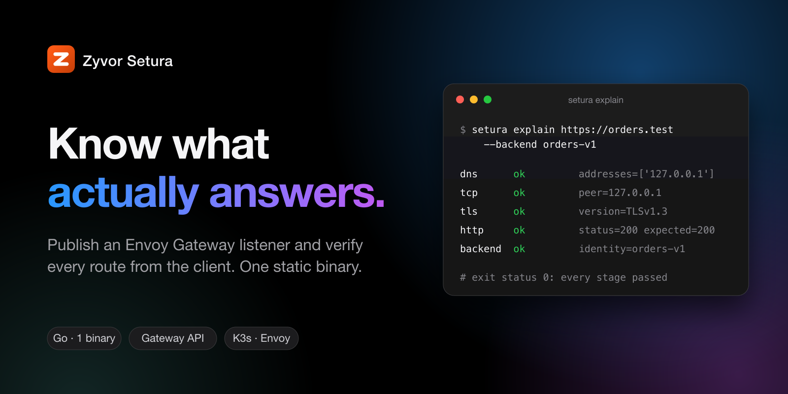
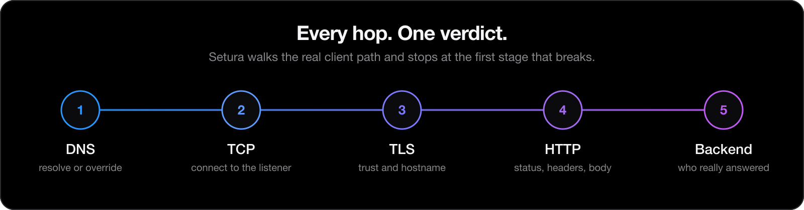

<div align="center">


# Zyvor Setura

**Know what actually answers.** Publish an Envoy Gateway listener and verify every Gateway API route from the client.

[](https://github.com/zyvorai/zyvor-setura-gateway/actions/workflows/ci.yml)
[](https://github.com/zyvorai/zyvor-setura-gateway/releases)
[](go.mod)
[](LICENSE)

[](https://zyvor.dev/buy?utm_source=github&utm_medium=setura&utm_campaign=readme_hero)
[](mailto:sales@zyvor.dev?subject=Zyvor%20Setura)
[](https://zyvorai.github.io/zyvor-setura-gateway/)

[Quickstart](#quickstart) · [Commands](#commands) · [Lint](#lint-your-routes-before-traffic-does) · [Route map](docs/map-ai.md) · [Operators guide](docs/operators.md) · [Pricing](#pricing-and-licensing)



</div>

---

A route can be **Accepted**, **Programmed**, and still send your users to the wrong application. Cluster-side tools tell you what the controller believes. **Setura sends a real request down the client path** and tells you which hop broke, who really answered, and whether it is safe to roll forward.

It is one static Go binary for macOS and Linux. It reads through your existing `kubectl` credentials, changes nothing in the cluster, and the probe itself needs only the Go standard library.

<div align="center">

</div>

## Why Setura

| | |
| --- | --- |
| **Client-side truth** | Probes originate at the CLI, bypass proxy environment variables, preserve the HTTP `Host` and TLS server name, and can pin a numeric address (`--address`) without touching DNS. |
| **Gates, not guesses** | `gate` requires current parent status *and* a streak of passing probes, and resets the streak if the route object changes while it is checking. |
| **Evidence you can cite** | Every result is structured JSON with per-stage state. `ai` extracts numbered evidence and can ask a local Ollama model, which must cite evidence IDs or its answer is rejected. |
| **No cluster needed to lint** | `lint` and `map` work on a saved snapshot, so route review runs on a laptop or in CI. |
| **Honest exit codes** | `0` passed, `1` an observed failure, `2` a setup or usage error. A typo never looks like an outage. |

## Quickstart

**Install** a release binary from [Releases](https://github.com/zyvorai/zyvor-setura-gateway/releases) (macOS and Linux, arm64 and amd64), or build from source:

```sh
go install github.com/zyvorai/zyvor-setura-gateway/cmd/setura@latest
setura version
```

**Try the probe** with no Kubernetes at all. In one terminal:

```sh
python3 -m http.server 9090 --bind 127.0.0.1
```

In another:

```sh
setura explain http://localhost:9090/
```

```text
dns      ok           addresses=['::1', '127.0.0.1']
tcp      ok           peer=127.0.0.1
tls      unused
http     ok           status=200 expected=200
backend  unused
assert   unused
```

**Publish a real Gateway.** Use an isolated K3s cluster, or a cluster whose kubeconfig your Mac can reach. Check `kubectl config current-context` first, because the demo fixture creates a namespace and a cluster-scoped GatewayClass.

```sh
helm install eg oci://docker.io/envoyproxy/gateway-helm --version v1.8.6 \
  -n envoy-gateway-system --create-namespace --wait --timeout 5m
kubectl apply -f examples/demo.yaml
kubectl -n setura-demo rollout status deployment/orders
kubectl -n setura-demo wait gateway/dev --for=condition=Programmed --timeout=180s
setura publish dev -n setura-demo --listener web
```

Then, from another terminal on the same machine:

```sh
setura explain http://orders.mactra.test:8080/checkout --address 127.0.0.1 --backend orders-v1
setura check examples/checks.json
setura inspect orders -n setura-demo
```

The `--address` override connects to `127.0.0.1` while keeping the URL's hostname, so no `/etc/hosts` edit is needed. Forwarding stops when you press Ctrl-C or the selected proxy pod exits; rerun `publish` after a pod is replaced.

## Commands

| Command | What it does |
| --- | --- |
| `publish GATEWAY --listener NAME` | Finds the single matching Envoy Service and runs `kubectl port-forward` on `127.0.0.1`. `--dry-run` prints the exact command. |
| `explain URL` | One HTTP/1.1 GET with per-stage evidence: DNS, TCP, TLS, HTTP, backend, assertions. Flags: `--json`, `--status`, `--backend`, `--address`, `--ca`, `--timeout`, `--header`, `--body-contains`, `--max-ms`. |
| `check FILE` | Runs a JSON file of route assertions. `--junit FILE` also writes JUnit XML. Expected `404`s can be positive assertions. |
| `lint` | Static analysis of Gateway and HTTPRoute specs with stable rule IDs. Works offline on a snapshot. |
| `gate ROUTE URL` | Requires current parent status and consecutive passing probes before a rollout proceeds. |
| `compare URL --target dns --target IP` | Probes one URL through DNS and specific addresses to find the node that answers differently. |
| `inspect ROUTE` | Per-parent route conditions with observed generation, Service ports and EndpointSlice readiness counts. |
| `listeners GATEWAY` | Listener attachment, supported kinds and conditions. |
| `snapshot` / `diff BEFORE AFTER` | Capture Gateway and HTTPRoute specs, then compare. `diff` exits 1 when they differ. |
| `map` / `impact TARGET` | Render an interactive route graph, or list the routes that depend on a Service. |
| `ai REPORT [--model NAME]` | Summarize saved evidence, optionally with a local Ollama model. |
| `capabilities` · `exposure` · `doctor` | GatewayClass features, Service exposure and overlapping LoadBalancer ports, and RBAC checks. |
| `completion bash\|zsh\|fish` | Shell completion script. |

The global `--context` goes before the subcommand. Probe and check exit codes are `0` for passed assertions, `1` for an observed failure, and `2` for a usage or setup error.

## Assert more than a status code

A check case can require response headers, body text and a latency budget, on top of status and backend identity:

```json
[
  {
    "url": "https://orders.mactra.test/checkout",
    "address": "127.0.0.1",
    "backend": "orders-v1",
    "headers": { "X-Env": "staging" },
    "body_contains": "ready",
    "max_ms": 250
  }
]
```

A header value of `"*"` only requires the header to be present. The body check reads at most the first 1 MiB. Run the same file from a laptop, a CI job, or an in-cluster CronJob (see [`examples/cluster-check.yaml`](examples/cluster-check.yaml)).

## Lint your routes before traffic does

<div align="center">

</div>

```sh
setura snapshot -n apps > snapshot.json   # one cluster read
setura lint --snapshot snapshot.json      # then fully offline
setura lint --snapshot snapshot.json --format json --strict
```

| Rule | Severity | Catches |
| --- | --- | --- |
| `SET001` | error | HTTPRoute with no `parentRefs`, so no Gateway serves it |
| `SET002` | error | every `backendRef` in a rule has weight 0, so requests are dropped |
| `SET003` | warning | a rule with no backends and no redirect, which answers 500 |
| `SET004` | warning | cross-namespace backend that needs a ReferenceGrant |
| `SET005` | error | `sectionName` names a listener the Gateway does not declare |
| `SET006` | warning | route hostnames do not intersect the listener hostname |
| `SET007` | error | HTTPS or TLS listener with no `tls` block |
| `SET008` | error | duplicate listener name, or two listeners sharing port, protocol and hostname |
| `SET009` | warning | two routes match the same host and path on one parent |

`lint` exits `1` on errors, and on warnings too with `--strict`. It reads declared specs only, so it cannot see ReferenceGrants, controller status or runtime behavior. List the rules any time with `setura lint --rules`.

## See the dependencies

```sh
setura map -n apps > routes.html                       # interactive, self-contained
setura impact Service/apps/orders --snapshot snapshot.json
```

[Open the live sample map](https://zyvorai.github.io/zyvor-setura-gateway/route-map.html) or read the [map and AI walkthrough](docs/map-ai.md). Impact walks declared references upstream and ignores zero-weight backends.

## How it fits with other tools

Setura is complementary to the tools that read cluster state:

| Tool | Good at | Setura adds |
| --- | --- | --- |
| [`gwctl`](https://github.com/kubernetes-sigs/gwctl) | Read-only inspection of Gateway API resources and attached policies | A real request through the listener, and an offline lint |
| [`egctl`](https://gateway.envoyproxy.io/docs/tasks/operations/egctl/) | Envoy Gateway config translation and status | Controller-neutral client checks and rollout gates |
| [Gateway API conformance suite](https://gateway-api.sigs.k8s.io/concepts/conformance) | Proving an *implementation* meets the spec | Proving *your routes* behave, on every deploy |

## Verification

`make test` runs the suite with the race detector. Socket tests use real loopback HTTP and TLS servers with a certificate generated in the test, and Kubernetes responses are fixtures. See the [verification record](docs/verification.md) for exactly what has and has not been run on a live cluster.

## Pricing and licensing

Zyvor Setura is **source-available** under the **[Zyvor Production License v1.0](LICENSE)** (SPDX `LicenseRef-Zyvor-Production-1.0`, also in [LICENSES/](LICENSES/LicenseRef-Zyvor-Production-1.0.txt); see [NOTICE](NOTICE)). Evaluation, development, testing, research and education are free for 30 days per organization. Production use requires a commercial license from Zyvor AI Labs Private Limited.

| Plan | Price | For |
| --- | --- | --- |
| **Evaluate** | Free for 30 days per organization | Trying it out and all non-production use |
| **Production** | **USD 101** / cluster / year · INR 9,999 incl. 18% GST in India | Each cluster you gate, probe and lint in production |
| **Team** | **USD 505** / year for up to 10 clusters · INR 49,999 incl. 18% GST in India | Platform teams running several clusters |
| **Enterprise** | Custom | More than 10 clusters, supported releases, an SLA and a named contact |

Prices: INR includes 18% GST in India; US dollars are for customers outside India and exclude tax.

[](https://zyvor.dev/buy?utm_source=github&utm_medium=setura&utm_campaign=readme_pricing)
[](mailto:sales@zyvor.dev?subject=Zyvor%20Setura)

Buy or get a quote at [zyvor.dev/buy](https://zyvor.dev/buy?utm_source=github&utm_medium=setura&utm_campaign=readme_license) · [Pricing](https://zyvor.dev/pricing?utm_source=github&utm_medium=setura&utm_campaign=readme_license) · [sales@zyvor.dev](mailto:sales@zyvor.dev). A 30-day trial key is available at [zyvor.dev/trial/start](https://zyvor.dev/trial/start).

If it helps you, you can donate any amount you like: <https://rzp.io/rzp/utwdYh3>. A donation is voluntary and supports development and maintenance. It is not a purchase: it buys no support, SLA, features, priority or license, and it is not tax-deductible (Zyvor AI Labs Private Limited is a company, not a charity). Zyvor Enterprise (supported releases, SLAs, a named contact and enterprise features) is separate: [sales@zyvor.dev](mailto:sales@zyvor.dev).

## Contributing and security

Source contributions are by arrangement with Zyvor AI Labs ([sales@zyvor.dev](mailto:sales@zyvor.dev)); see [CONTRIBUTING.md](CONTRIBUTING.md). Report vulnerabilities privately as described in [SECURITY.md](SECURITY.md). Release notes are in [CHANGELOG.md](CHANGELOG.md).

<div align="center">

Copyright © 2026 Zyvor AI Labs Private Limited · [zyvor.dev](https://zyvor.dev)

</div>
